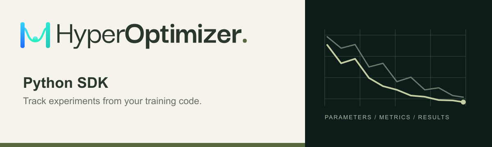

# HyperOptimizer Python SDK

[](https://pypi.org/project/hyperoptimizer/)
[](https://pypi.org/project/hyperoptimizer/)
[](https://github.com/hyperoptimizer/python-sdk/actions/workflows/python-sdk.yml)
[](LICENSE)

Track Python experiments with [HyperOptimizer](https://hyperoptimizer.com).
Log metrics, parameters, histograms, and results from your training code, then
explore your runs in the dashboard. Requires Python 3.10+; uses HTTPX for pooled HTTP connections.

[Documentation](https://docs.hyperoptimizer.com/guides/python-tracking) ·
[Dashboard](https://app.hyperoptimizer.com) ·
[PyPI](https://pypi.org/project/hyperoptimizer/) ·
[Issues](https://github.com/hyperoptimizer/python-sdk/issues)

## Installation

```sh
pip install hyperoptimizer
```

## Getting started

Create an API key from the **API Keys** page in the
[dashboard](https://app.hyperoptimizer.com), then set it in your environment:

```sh
export HYPEROPTIMIZER_API_TOKEN="hyperoptimizer_your_org_token"
```

The example below needs `projects:write`, `experiments:write`, and
`tracking:write` scopes. External tracking requires an active paid subscription.

```python
from hyperoptimizer import Run
from hyperoptimizer.projects import create_project

project = create_project(name="my-first-project")

with Run(project=project.id, experiment_name="training") as run:
    run.log_configs({
        "parameters/learning_rate": 0.001,
        "parameters/batch_size": 32,
    })

    for step in range(10):
        run.log_metrics({"loss": 1.0 / (step + 1)}, step=step)

    run.add_tags(["baseline"])
    print(run.get_run_url())
```

Open the printed URL to view your run. The `with` block flushes pending events
and closes the run automatically. If your code raises an exception, the SDK
attempts to mark the run as failed and preserves the original exception.

## Usage

### Use an existing project or experiment

Set a default project to avoid passing its ID each time:

```sh
export HYPEROPTIMIZER_PROJECT_ID="your_project_id"
```

```python
from hyperoptimizer import Run

with Run(experiment_name="training") as run:
    run.log_metrics({"accuracy": 0.92}, step=0)
```

Experiment names are resolved within the project: reusing a name reuses the
experiment. You can also pass `experiment_id` instead of `experiment_name`.
With existing project and experiment IDs, only `tracking:write` is required.

### Log parameters and configuration

Use the `parameters/` prefix for string, numeric, and boolean parameters.
Other fields can contain structured JSON, including `null` (`None` in Python).
The following logging examples use an open `run` from a `with Run(...)` block.

```python
run.log_configs({
    "parameters/learning_rate": 0.001,
    "parameters/use_dropout": True,
    "dataset": {"name": "mnist", "version": 2},
})
```

### Log metrics and histograms

Record scalar metrics at a nonnegative integer step. Use slash-separated paths
for related fields.

```python
from hyperoptimizer.types import Histogram

run.log_metrics({"train/loss": 0.25, "validation/accuracy": 0.92}, step=10)
run.log_histograms({
    "activations": Histogram(bin_edges=[0, 1, 2], counts=[4, 6]),
}, step=10)
```

A histogram needs one more bin edge than count, with strictly increasing edges
and nonnegative integer counts. Each histogram supports 1–256 bins.

### Set final metric policies

Choose how metrics are summarized when first creating an experiment. Using
`project` from the getting-started example:

```python
with Run(
    project=project.id,
    experiment_name="scoring",
    metric_policies={"loss": "min", "score": "explicit"},
) as run:
    run.log_metrics({"loss": 0.25}, step=10)
    run.log_results({"score": 0.9})
```

| Policy | Final value |
| --- | --- |
| `last` | Value at the highest step |
| `min` | Lowest recorded value |
| `max` | Highest recorded value |
| `mean` | Mean of recorded values |
| `explicit` | Write-once result supplied with `log_results()` |

Policies are fixed for each run, and conflicting policies on an existing
experiment are rejected. Closing a run freezes its final metrics.

### Organize runs with tags

Inside an open run:

```python
run.add_tags(["baseline", "resnet"])
run.remove_tags(["baseline"])
run.add_tags(["ablation-study"], group_tags=True)
```

### Resume an interrupted run

A run has one active writer. After an interrupted run's five-minute writer
lease expires, resume it using its project, experiment, and run IDs:

```python
with Run(
    project="your_project_id",
    experiment_id="your_experiment_id",
    run_id="your_run_id",
    resume=True,
) as run:
    run.log_metrics({"loss": 0.18}, step=11)
```

Closed runs cannot be reopened. Save `run.id`, `run.project_id`, and
`run.experiment_id` alongside your training checkpoint if you need to resume.

## Configuration

| Environment variable | Purpose | Default |
| --- | --- | --- |
| `HYPEROPTIMIZER_API_TOKEN` | Organization API key | Required for external tracking |
| `HYPEROPTIMIZER_PROJECT_ID` | Default project ID | Pass `project` to `Run()` otherwise |
| `HYPEROPTIMIZER_API_URL` | API origin or full GraphQL endpoint | `https://graphql.hyperoptimizer.com` |
| `HYPEROPTIMIZER_APP_URL` | Dashboard origin for run links | `https://app.hyperoptimizer.com` |

You can also pass `api_token` and `api_url` directly to `Run()` or
`create_project()`. API keys determine the organization; an optional
`create_project(workspace=...)` value must match the key's organization.

All SDK requests use `/graphql`. Public endpoints require HTTPS; loopback HTTP
is supported for local development:

```sh
export HYPEROPTIMIZER_API_URL="http://127.0.0.1:8186"
export HYPEROPTIMIZER_APP_URL="http://127.0.0.1:3003"
```

## Delivery and limits

Events upload in the background, normally every second or when 500 events are
queued. `run.flush()` waits for pending events to be acknowledged;
`run.close()` also finalizes the run and is safe to call more than once.
Both raise `hyperoptimizer.TrackingError` if delivery fails. Timeout values bound
individual network phases and retry scheduling, rather than guaranteeing strict
wall-clock cancellation. The SDK honors environment proxy settings and the
platform/OpenSSL certificate configuration. Requests identify the SDK version and
operating system, for example `hyperoptimizer-python/0.1.0/linux`.

- **Buffering:** up to 10,000 events or 16 MiB in memory, with bounded
  backpressure. Abrupt termination can lose buffered events; there is no disk queue.
- **Retries:** event identities are preserved. Identical replays are acknowledged;
  conflicting values for the same metric path and step are rejected.
- **Values:** scalar metrics must be finite numbers, excluding booleans. Steps
  and histogram counts range from `0` to `2**53 - 1`.
- **Configuration:** up to 64 KiB per value, 1 MiB total, and 1,000 fields per run.
  Paths preserve case; `sys` and `system` are reserved namespaces.
- **Histograms:** the 100 snapshots with the greatest steps are retained per field.

<details>
<summary>Managed execution status</summary>

The SDK supports `Run()` with platform-injected tracking credentials, scoped to
one managed run. These credentials cannot create projects or write to other
runs, and closing telemetry does not change the platform's execution status.

Worker integration is still pending. The managed SDK protocol is tested with
fixtures; end-to-end managed optimization has not yet been validated on this
stack. External tracking does not create or bill managed compute.

</details>

## Development

From a local checkout:

```sh
pip install -e .
python -m unittest discover -s tests -v
```

In the platform monorepo, `pnpm --filter graphql.hyperoptimizer.com test:sdk`
runs the Python-client integration tests, and `pnpm check:tracking-sdk`
validates the bundled GraphQL operations against the exported schema.

See [RELEASING.md](RELEASING.md) for package publishing instructions.
Report bugs and request features through
[GitHub Issues](https://github.com/hyperoptimizer/python-sdk/issues).

## License

[MIT](LICENSE) © HyperOptimizer.
